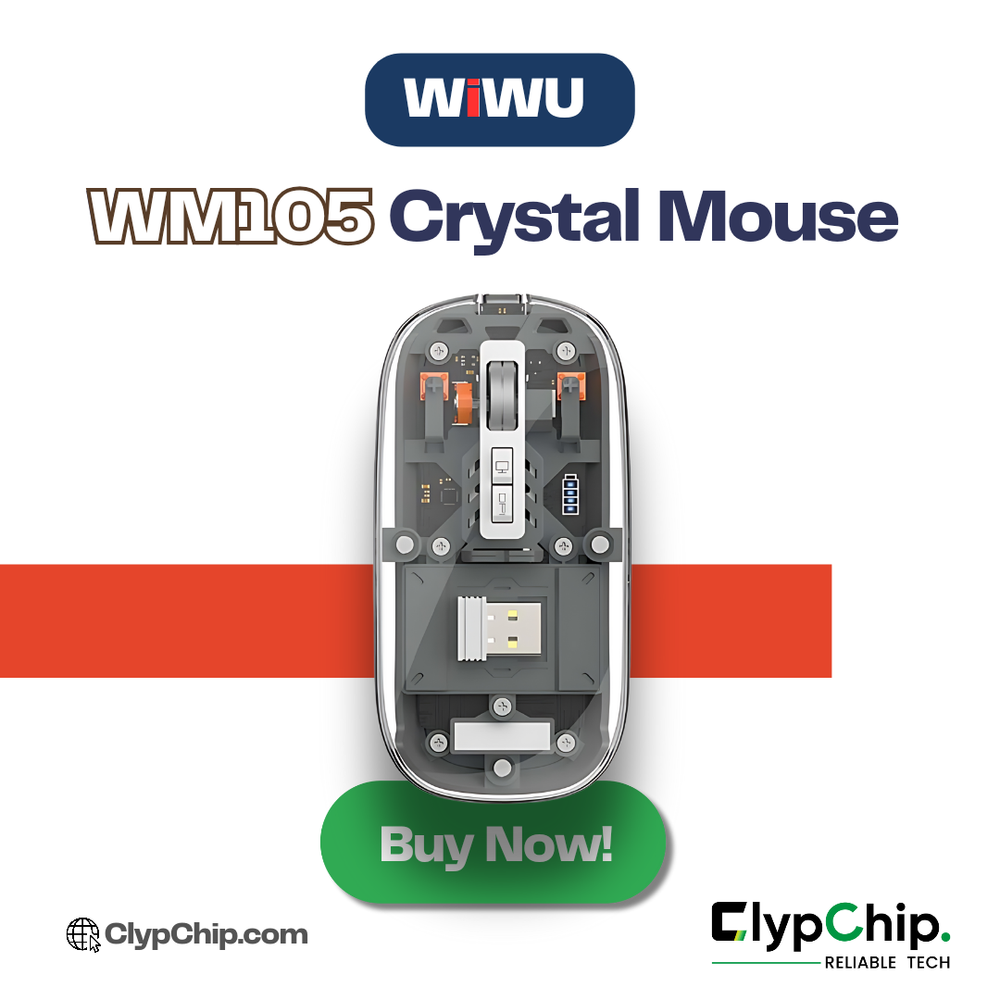
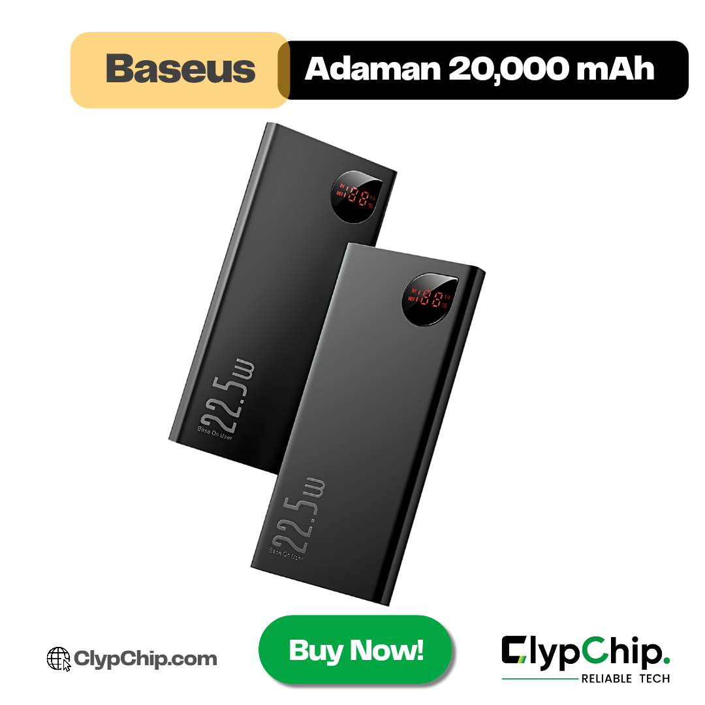
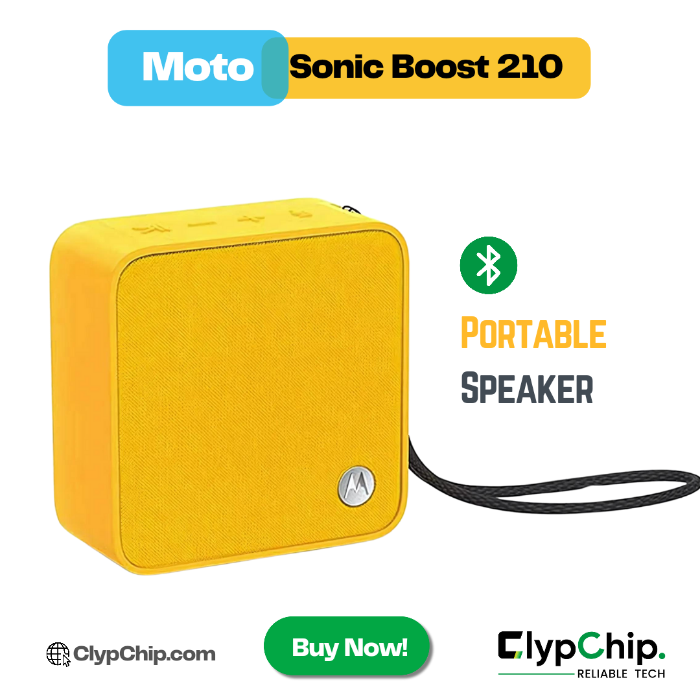
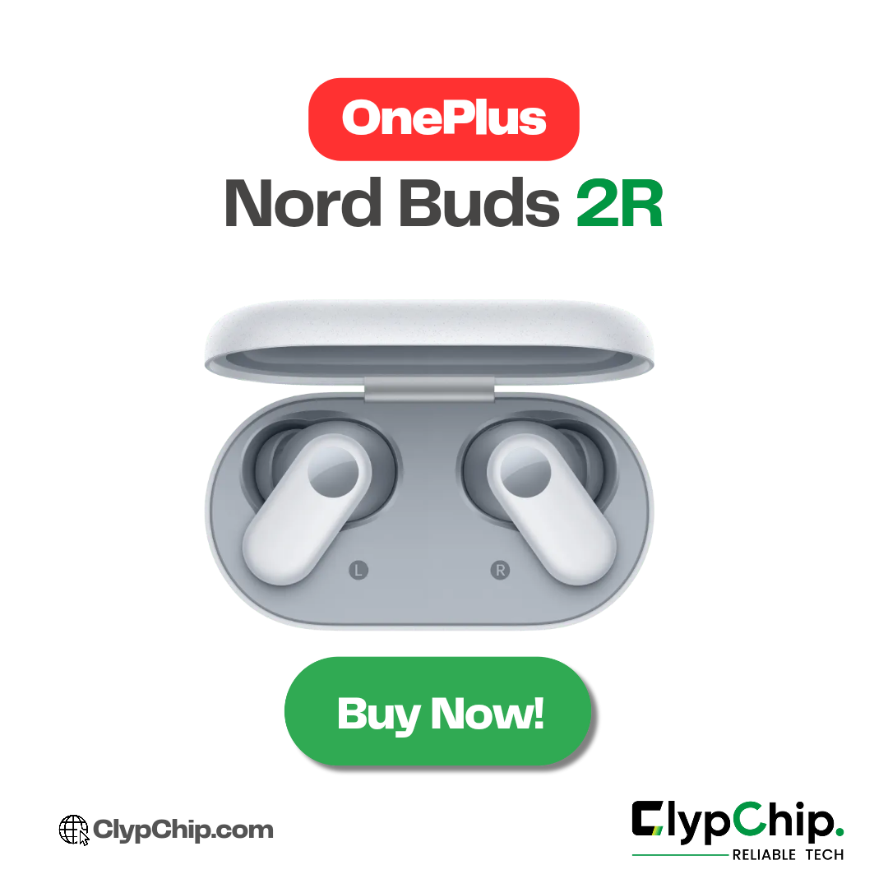
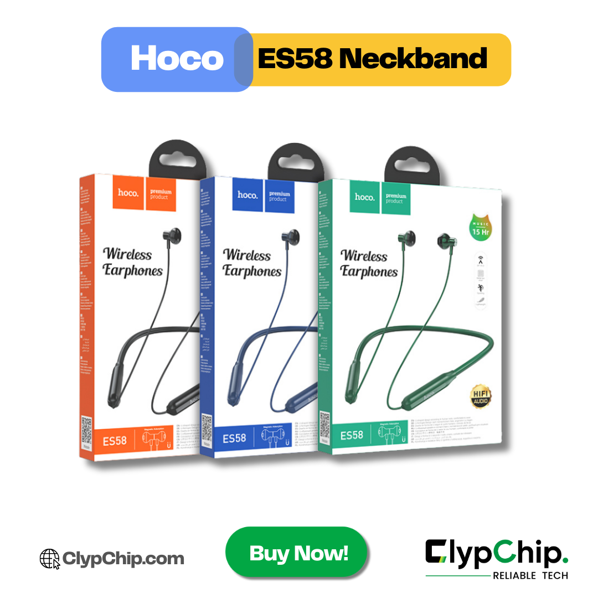

# ClypChip: gadget marketing through page growth and messaging

**Role:** Owner and digital marketer, Md Jahid Hasan  
**Market:** Bangladesh, especially Dhaka  
**Evidence:** June–September 2024 advertising exports; August–October 2024 owner-reported sales; six creative examples.

## Business and goals

ClypChip was an online gadget shop. I handled the campaigns end to end, including creative production, audience decisions and campaign management. Page-like campaigns supported audience growth. Product messaging campaigns sought enquiries and direct sales.

## Audience decisions

I narrowed the audience to men aged 18–35 after observing that most customers were in that range. I removed women from targeting after observing limited clicks and results from that audience. I recall using interests related to gadgets, shopping and students, but the exact historical selections are no longer available.

These decisions are my retrospective account. The exports do not establish the date of each change or prove its incremental effect, so no percentage improvement is claimed.

## Advertising results

| Reporting period | Campaign | Spend | Reported result | Cost per result |
| --- | --- | ---: | --- | ---: |
| Jun–Jul 2024 | Final Like Follow 1 | BDT 2,945.34 | 535 Facebook likes | BDT 5.51 |
| Jun–Jul 2024 | Promoting ClypChip | BDT 1,925.77 | 430 Facebook likes | BDT 4.48 |
| Aug–Sep 2024 | Page Like Campaign 3 | USD 7.44 | 284 Facebook likes | USD 0.0262 |
| Aug–Sep 2024 | Wiwu WM105 Mouse | USD 5.61 | 129 conversations started | USD 0.0435 |
| Aug–Sep 2024 | Baseus Adaman | USD 5.47 | 158 conversations started | USD 0.0346 |
| Aug–Sep 2024 | Carousel AD 1 | USD 5.46 | 67 conversations started | USD 0.0815 |

The three messaging campaigns recorded **354 conversations started on USD 16.54 spend**, approximately **USD 0.0467 per conversation**. Conversations are platform events, not confirmed buyers or unique customers across campaigns.

June–July spend totalled BDT 4,871.11 for 965 Facebook likes. Using my historical conversion convention of BDT 120 per USD, that spend is approximately USD 40.59. Original currencies are preserved; this is an indicative conversion, not a verified billing exchange rate.

## Product sales and unit economics

I report the following sales quantities for **August–October 2024**, when I also received recurring customers. I later stopped the ads. These quantities and prices are my recollections, not a reconciled order ledger or Meta purchase attribution.

| Product | Units reported | Purchase price (BDT/unit) | Selling price (BDT/unit) | Price spread before other costs (BDT/unit) |
| --- | ---: | ---: | ---: | ---: |
| Wiwu WM105 mouse | Approximately 70 | 900 | 1,700 | 800 |
| Baseus power bank | 15 | 1,900 | 2,900 | 1,000 |
| OnePlus Nord Buds 2R | 3 | 6,500 | 8,000 | 1,500 |
| Moto Sonic Boost speaker | 12 | 250 | 1,200 | 950 |
| Hoco ES58 neckband | 9 | 350 | 1,050 | 700 |

The mouse had the highest reported unit sales. The Baseus campaign had the lowest reported cost per messaging conversation. Those are different measures; one does not establish the other.

Price spread excludes advertising, delivery, packaging, payment fees, returns, discounts, taxes and overhead. It is not net profit. Sales span a longer period than the supplied messaging report and include recurring customers. Therefore, I do not claim verified ROAS, sales conversion rate, campaign-attributed sales or complete business profitability from these records.

## Creative examples

The supplied compositions use product names, prominent product imagery, ClypChip branding and direct calls to action. The general promotional image advertises up to 20% off; that offer is not assumed to apply to every product or campaign. Exact ad-to-creative matching and carousel card order have not been independently established.

### Wiwu WM105 mouse

### Baseus Adaman power bank

### Moto Sonic Boost speaker

### OnePlus Nord Buds 2R

### Hoco ES58 neckband

### General promotion

## What this work demonstrates

- Managing a small online retail brand's advertising and creative workflow.
- Adapting targeting based on observed customer and audience response.
- Reporting results with consistent definitions and without counting repeated export totals twice.
- Distinguishing audience growth, conversations, product units and profitability.
- Recognising the need for dated change logs, order matching and returning-customer records in future campaigns.

## Reproduce and inspect

See [campaign-summary.csv](campaign-summary.csv), [product-economics.csv](product-economics.csv), [source-jun-jul-2024.xlsx](source-jun-jul-2024.xlsx), [source-aug-sep-2024.xlsx](source-aug-sep-2024.xlsx) and the [data dictionary](DATA-DICTIONARY.md). Run `python3 analyse.py` to reproduce the documented calculations.

This is a retrospective case study assembled from original exports, supplied creatives and my written account. The reporting template and analysis script are newly prepared portfolio resources.
